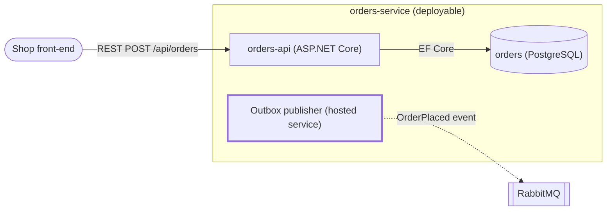

# Design Sketches — Mermaid in Markdown

Every design artifact this pipeline writes (`01-context-*.md`, `01-current-c4.md`, `02-proposal-*.md`,
`03-decision.md`, the spec) carries its diagrams **inline as ```mermaid fences**. A sketch is text:
it diffs in a merge request, renders in GitLab, GitHub, VS Code (Markdown Preview Mermaid Support)
and Claude artifacts, and the same block can be handed to a FigJam import later without redrawing.
Never ASCII art, never an image file, never a diagram described only in prose.

## Which view, which diagram type

| Audience question | View | Mermaid type |
|---|---|---|
| Who talks to the system and what sits around it? | Context | `flowchart LR`; one node per system, actors as `([Actor])` |
| Which deployable units, stores and queues exist and how do they connect? | Container | `flowchart LR`; one `subgraph` per deployable unit or bounded context |
| What is inside the one or two units the change touches? | Component | `flowchart TB` inside the container's `subgraph` |
| How does the critical request, job or event actually flow, and what happens when a hop fails? | Dynamic | `sequenceDiagram`; one happy path, one failure path (`alt`/`opt`) |
| Which tables or documents change, and how do they relate? | Data | `erDiagram`; only the entities the change touches |
| What states does an aggregate or job move through? | Lifecycle | `stateDiagram-v2` |

Do not use Mermaid's `C4Context`/`C4Container` syntax: it is marked experimental and renders
inconsistently across viewers. `flowchart` with `subgraph` expresses the same C4 levels and
renders everywhere.

## Rules for every block

- **Title and scope line above the fence**: `**Container view — current state, order-service and its neighbours (observed 2026-09-06)**`.
- **Stable ids, display labels**: `orders_api["orders-api (ASP.NET Core)"]`. Ids never change between revisions; labels may.
- **Every edge is labelled** with intent and protocol or payload: `-->|gRPC GetOrder|`, `-.->|OrderPlaced event|`. Dashed edges are asynchronous; solid edges are synchronous.
- **Current vs target is visible in the diagram itself**, not only in the heading: current elements plain, new or changed elements with `:::target`, removed elements with `:::removed`, declared once per block:
  `classDef target stroke-width:3px,stroke-dasharray:0; classDef removed stroke-dasharray:4 2;` — never colour as the only carrier.
- **Legend under the fence** naming every class, line style and abbreviation used.
- **At most ~25 nodes per view**; split a bigger story into two views rather than shrinking labels.
- **Unknowns stay unknown**: an unverified relationship is drawn with `-.?.->` and listed under the diagram as `UNKNOWN`, never completed for looks.
- **Names match the code**: project names from `get_project_graph`, endpoint paths from `get_endpoint_map`, queue and cache names as grepped. A name that exists only in the diagram is a defect.

## Minimum per artifact

| Artifact | Required views |
|---|---|
| `01-context-<project>.md` | container view of that project; component view only for the projects the brief touches |
| `01-current-c4.md` | one context view, one merged container view |
| `02-proposal-<lens>.md` | target container (or component) view with `:::target` marks; one `sequenceDiagram` of the critical flow including its failure path; `erDiagram` when the proposal changes data |
| `03-decision.md` | the winner's target view, with borrowed elements from other proposals marked `:::target` and attributed in the legend |
| spec `## Design` | the approved proposal's views verbatim; do not redraw |

## Templates



```mermaid
sequenceDiagram
  participant S as Shop
  participant O as orders-api
  participant D as orders DB
  participant B as RabbitMQ
  S->>O: POST /api/orders
  O->>D: INSERT order + outbox row (one transaction)
  D-->>O: ok
  O-->>S: 201 Created
  alt broker unavailable
    O-xB: publish fails
    Note over O,B: outbox row stays; publisher retries with back-off
  else broker up
    O-)B: OrderPlaced
  end
```
